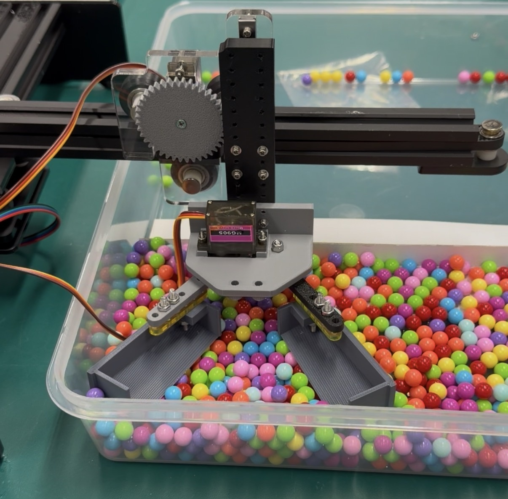
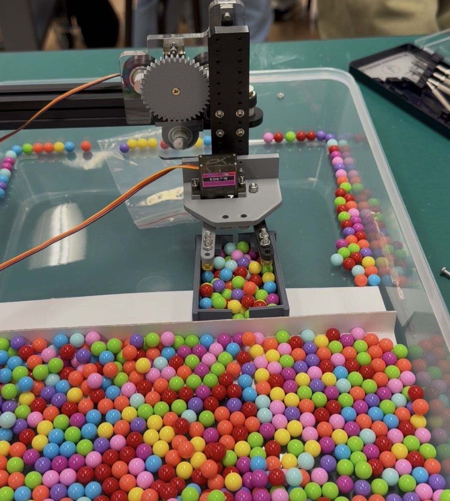

# A robotic gripper for collecting BB pellets

**Lixun Lin · ISE2117 · The Hong Kong Polytechnic University**

I designed and built this end effector to pick up multiple loose BB pellets in one motion. In a course test, I collected **57 pellets in a single pickup**.

| Open jaws | Closed jaws |
| :--- | :--- |
|  |  |

## How it works

Loose pellets roll away when pushed. I used two opposing scoops so the gripper could gather a batch from below. With the jaws open, pellets sit between the scoops. As the jaws close, the two floors meet and the raised edges keep the pellets inside. A servo mounted above the jaws drives their motion through the linkages visible in the photos.

## My contribution

I completed the end effector as an individual project. I modelled the parts in SolidWorks, fabricated and assembled the prototype, then tested it on the course rig. The photos show my gripper mounted below the horizontal rail.
